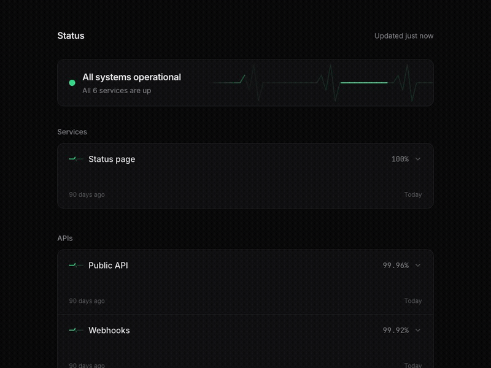

<p align="center"></p>

<h1 align="center">upbeat</h1>

<p align="center">A beautiful, animated status page for UptimeRobot.<br>One read-only API key, no database, deploy in a minute.</p>

<p align="center">
  <a href="https://github.com/Jubstaaa/upbeat/actions/workflows/ci.yml"></a>
  <a href="https://github.com/Jubstaaa/upbeat/releases"></a>
  <a href="https://github.com/Jubstaaa/upbeat/pkgs/container/upbeat"></a>
  <a href="LICENSE"></a>
  <a href="https://status.webgooh.tech"></a>
</p>

<p align="center"></p>

**Live demo:** [status.webgooh.tech](https://status.webgooh.tech)

## What makes it different

- **It feels alive.** A heartbeat runs across the summary card and every row. It speeds up and turns red when something goes down, and flatlines on the service that is down.
- **Your key stays on the server.** The browser only ever receives the numbers the page shows. UptimeRobot's read-only key can still list every monitor and your alert contacts, so upbeat never ships it to visitors.
- **It runs on Cloudflare's free plan.** The page is static files served straight from Cloudflare's edge; only `/api/status`, the badge and the feed run code, and they answer from a one-minute edge cache in a millisecond or two.
- **It is kind to rate limits.** About one UptimeRobot refresh a minute per server, however many people are watching, shared by the page, the badge and the feed.
- **Nothing to edit.** Configure everything with environment variables, group monitors by renaming them in UptimeRobot, and pull upstream updates without merge conflicts.

## Features

- Overall status with a live heartbeat; the tab title and favicon follow it
- 90 days of daily uptime bars per monitor, with a tooltip per day (30 days on phones)
- 24-hour response-time sparkline per monitor
- Click a row to expand its response-time chart and outage history; `#monitor-id` links open it directly
- Recent incidents, with simultaneous outages merged into one
- Groups from monitor names (`Websites / example.com`)
- Scheduled maintenance banner (paid UptimeRobot plans)
- README badges for the whole page or one monitor
- Atom feed of incidents and maintenance
- Light and dark themes, `prefers-reduced-motion` support, accent colour
- Demo mode with sample data

## Deploy

You need a **read-only API key**: UptimeRobot → [Integrations & API](https://dashboard.uptimerobot.com/integrations) → Read-only API key.

### Cloudflare Workers

[](https://deploy.workers.cloudflare.com/?url=https://github.com/Jubstaaa/upbeat)

Paste the key when asked for `UPTIMEROBOT_API_KEY`. To deploy from a clone instead:

```sh
bun install
bunx wrangler secret put UPTIMEROBOT_API_KEY
bun run deploy
```

Serving it from your own domain? Deploy with `CLOUDFLARE_ENV=production bun run deploy` to turn off the `workers.dev` and preview URLs (the `production` environment in `wrangler.jsonc` deploys the same `upbeat` Worker).

### Docker

```sh
docker run -d -p 3000:3000 -e UPTIMEROBOT_API_KEY=ur123456-abcdef ghcr.io/jubstaaa/upbeat:1
```

Images are published for `linux/amd64` and `linux/arm64`. Tags: `1`, `1.0`, `1.0.0`, `latest`.

### Try it without a key

```sh
docker run -p 3000:3000 -e DEMO=true ghcr.io/jubstaaa/upbeat:1
```

## Configuration

| Variable              | Required         | Default                   | What it does                                      |
| --------------------- | ---------------- | ------------------------- | ------------------------------------------------- |
| `UPTIMEROBOT_API_KEY` | yes, unless demo |                           | Read-only UptimeRobot API key                     |
| `SITE_TITLE`          | no               | `Status`                  | Page title and header                             |
| `SITE_DESCRIPTION`    | no               | `Live status and uptime.` | Meta description                                  |
| `SITE_LOGO`           | no               |                           | Logo URL (`https://…` or a path like `/logo.png`) |
| `SITE_URL`            | no               | the request's origin      | Absolute links in the feed                        |
| `ACCENT_COLOR`        | no               | the theme's green         | Hex colour for "up", e.g. `#6366f1`               |
| `DEMO`                | no               | `false`                   | Serve sample data without a key                   |

Invalid values are ignored with a log line, never a crash. Set `SITE_URL` when upbeat runs behind a proxy, so feed links use your public address.

## Groups

Name a monitor `Group / Name` in UptimeRobot and it appears under that group: `Websites / example.com` shows as `example.com` under **Websites**. The separator is a slash with spaces around it, so URL-like names such as `api.example.com/health` stay as they are. Monitors without a group are listed first under **Services**. Groups and monitors are sorted alphabetically.

## Badges

Live from [status.webgooh.tech](https://status.webgooh.tech):

[](https://status.webgooh.tech)
[](https://status.webgooh.tech/#webgooh-tech)
[](https://status.webgooh.tech/#ilkerbalcilar-com)

Add them to your own README:

```markdown


```

The overall badge reads `status | operational`, `degraded`, `outage` or `maintenance`. A monitor badge reads `<name> | up 99.98%`. The monitor id is the one in the page's `#…` link when you expand its row.

## Feed

Subscribe to `https://status.example.com/feed.xml` in any feed reader to hear about incidents and scheduled maintenance.

## How it works

upbeat is a React single-page app built with Vite, plus a small [Hono](https://hono.dev) API. The page is plain static files. The API calls UptimeRobot's `getMonitors` at most once a minute, keeps the result in memory and, on Cloudflare, in the edge cache, and returns only what the page shows. The page loads `/api/status` and refreshes it every minute. If UptimeRobot is unreachable, the last good data keeps showing with a "Data may be out of date" note.

On Cloudflare the same code runs as one Worker with static assets; in Docker it runs on Bun, which serves both the API and the page.

## Known limits

- Maintenance windows only exist on paid UptimeRobot plans, and upbeat shows one-time windows only; recurring windows are skipped because their times have no time zone in the API.
- History is fixed at 90 days and days are in UTC.
- Data is at most a minute behind UptimeRobot, which itself checks every 5 minutes on the free plan.
- One UptimeRobot account per deployment; every monitor the key can read is shown. To hide a monitor, use a separate UptimeRobot account or remove it.
- The cache lives in each server instance. On Cloudflare, several instances can each refresh once a minute, which stays well inside UptimeRobot's free-plan limit of 10 requests a minute for a personal page.
- Deploying to Vercel is not supported yet.

## Development

```sh
bun install
echo 'DEMO=true' > .dev.vars
bun run dev
```

Checks: `bun run lint`, `bun run format:check`, `bun run type-check`, `bun run test`, and `bun run build && bun run test:e2e`. See [CONTRIBUTING.md](CONTRIBUTING.md).

## License

[MIT](LICENSE)
